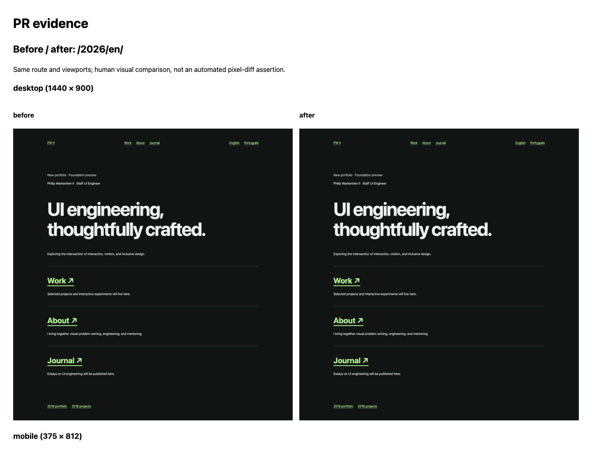

# AI workflow implementation verification

This change upgrades developer tooling; it does not redesign or change the portfolio UI. The BEFORE and AFTER captures intentionally use the unchanged `/2026/en/` page. Their desktop and mobile PNG hashes match byte for byte. This demonstrates reproducible capture and comparison, not a product visual difference.

Verified with Node 22.23.4:

- `npm ci` and `npx playwright install chromium` complete; npm reports zero dependency advisories.
- `npm run check`: TypeScript, both builds, 13 native tests, and all 30 existing Playwright desktop/mobile tests pass, including the existing axe and keyboard checks.
- `PORTFOLIO_PORT=4175 npm run evidence:ui -- --name workflow-verification --phase before --route /2026/en/ --note "Workflow verification; application UI unchanged"`, then the same command with `--phase after`: four screenshots with matching route/viewports, separate traces/reports, and a paired HTML/Markdown report.
- `PORTFOLIO_PORT=4175 npm run evidence:ux -- --name workflow-verification`: four passing existing keyboard/routing story tests, four WebM videos, four traces, and state images from the actual interactions. Videos were loaded and decoded in Chromium for playback review.
- Workflow YAML, embedded shell syntax, new JavaScript module syntax, both repository skills, and `git diff --check` validate.

The full raw reports/media are ignored under `artifacts/evidence/workflow-verification/`, not committed or deployed. CI captures the existing navigation stories into its downloadable `playwright-report` artifact. PR reviewers can download/extract it from the validation run and open `artifacts/evidence/ci-navigation/index.html` for the report, recordings, images, and traces. Retention is 14 days; the small curated comparison above remains in Git.

No performance-sensitive application code changed. No model/effort switching is claimed, and no linter, component framework, pixel-diff baseline, or performance tool is introduced. Existing legacy Sass deprecation warnings remain. Automated browser/axe checks do not establish full screen-reader or cross-browser accessibility.
